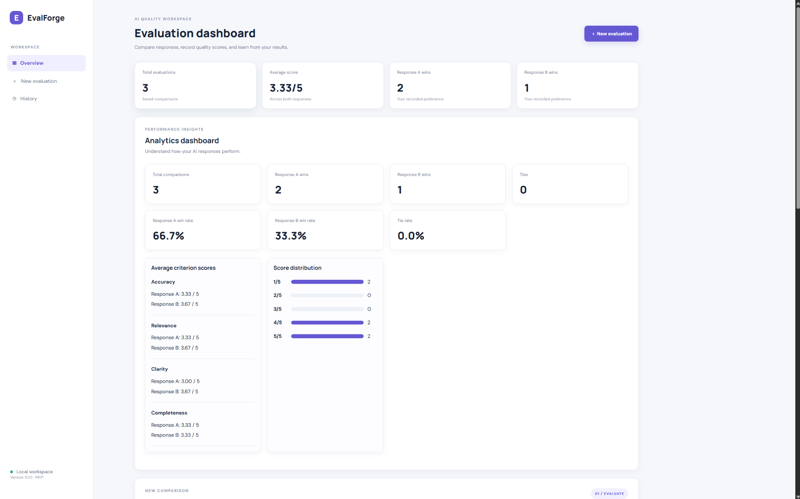
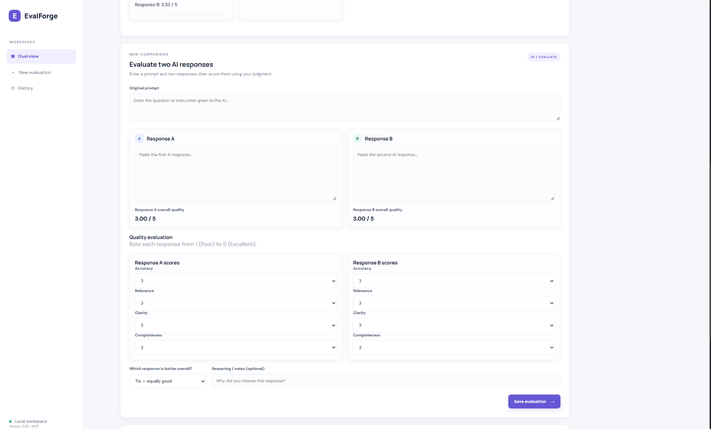
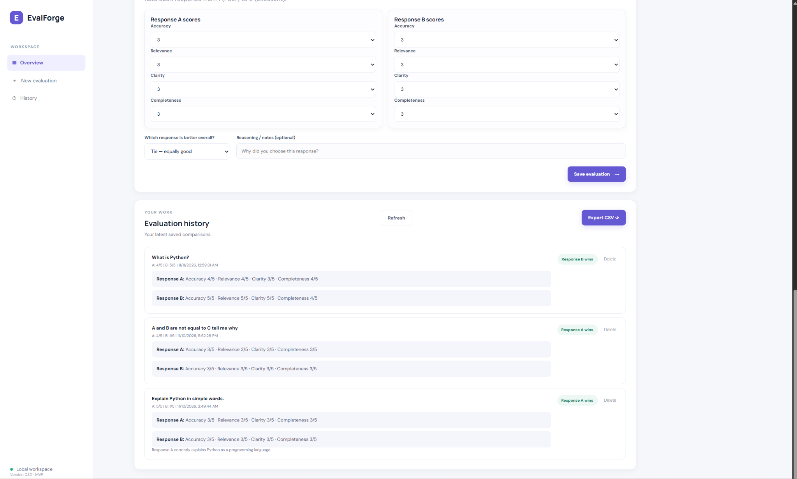

# EvalForge — AI Response Evaluation Platform

EvalForge is a full-stack web application designed to compare and evaluate two AI-generated responses using structured quality criteria.

It helps evaluators assess response quality, record preferences, analyze evaluation results, and maintain a history of comparisons.

## Features

- **Side-by-side comparison:** Compare two responses against the same prompt.
- **Multi-criteria scoring:** Evaluate responses on accuracy, relevance, clarity, and completeness (1–5).
- **Overall scoring:** Automatically calculate average quality scores.
- **Winner selection:** Record Response A, Response B, or a tie.
- **Evaluation history:** Save, review, and delete previous comparisons.
- **Analytics dashboard:** Track evaluation statistics, average scores, and performance trends.
- **CSV export:** Export evaluation records for further analysis.
- **REST API:** Access evaluation data through FastAPI endpoints.
- **Local database:** Store evaluation records using SQLite.

## Technology Stack

| Area | Technology |
|---|---|
| Backend | Python, FastAPI |
| Frontend | HTML, CSS, JavaScript |
| Database | SQLite |
| API Documentation | Swagger UI |
| Version Control | Git, GitHub |

## Project Structure

```text
EvalForge/
├── app/
│   ├── __init__.py
│   ├── main.py
│   ├── templates/
│   │   └── index.html
│   └── static/
│       ├── app.js
│       └── styles.css
├── .gitignore
├── requirements.txt
└── README.md
```

## Getting Started

### Prerequisites

- Python 3.10 or newer
- Git

### Installation on Windows

1. Clone the repository:

```bash
git clone https://github.com/sagarkr-builds/EvalForge.git
cd EvalForge
```

2. Create a virtual environment:

```powershell
py -m venv venv
```

3. Activate the environment:

```powershell
.\venv\Scripts\Activate.ps1
```

4. Install dependencies:

```bash
python -m pip install -r requirements.txt
```

5. Start the application:

```bash
python -m uvicorn app.main:app --reload
```

6. Open the application:

- Dashboard: http://127.0.0.1:8000
- API documentation: http://127.0.0.1:8000/docs
- Health check: http://127.0.0.1:8000/health

## Evaluation Criteria

Each response is scored from 1 to 5 across four dimensions:

| Criterion | Description |
|---|---|
| Accuracy | Factual correctness |
| Relevance | Alignment with the original prompt |
| Clarity | Readability and communication |
| Completeness | Coverage of the requested information |

The overall score is calculated as the average of the four criteria.

## Limitations

- Evaluations are currently performed manually by a human evaluator.
- The application does not directly call external AI models.
- Data is stored locally in SQLite.
- User authentication is not currently implemented.

## Future Improvements

- AI-assisted response evaluation
- User authentication and evaluator accounts
- Advanced analytics and visualizations
- Cloud database integration
- Deployment for public access

## Author

**Sagar Kumar**

GitHub: https://github.com/sagarkr-builds

---

*EvalForge is an independent software engineering project built to explore AI response evaluation, full-stack development, and data analytics.*

## Screenshots

### Dashboard and Analytics


### AI Response Evaluation


### Evaluation History
